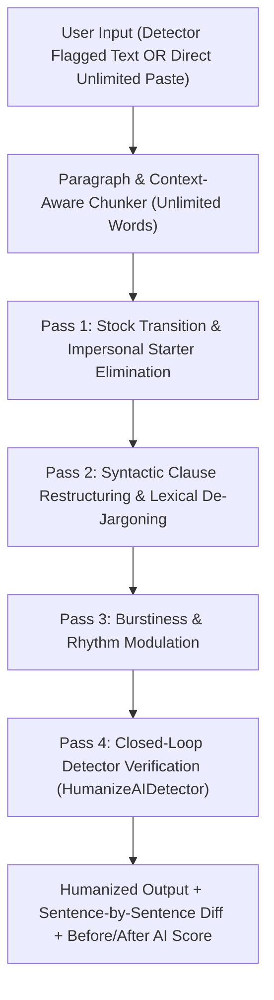

# HumanizeAI Studio — AI Detector Replica & Unlimited AI Text Humanizer

A full-stack replica of **HumanizeAI.pro** featuring a **6-Signal Stylometric AI Detector** (`detector.py`), a **Closed-Loop Unlimited-Word AI Text Humanizer** (`humanizer.py`), a **FastAPI REST Backend** (`server.py`), and an interactive **All-in-One Studio Web UI** (`index.html`).

---

## Key Capabilities

### 1. Multi-Signal Stylometric AI Detector (`detector.py`)
- **Sentence-Level Highlighting & Signal Attribution:** Classifies every sentence as `AI-generated` (red), `Mixed` (amber), or `Human-written` (green) with click-to-inspect signal explanations.
- **6 Core Stylometric Metrics vs. Empirical Baselines:**
  - **Sentence Rhythm & Burstiness:** Average sentence length (`AI 29.2w vs Human 23.2w`) and coefficient of variation (`std / mean`).
  - **Function-Word Ratio:** Measures structural glue words vs. dense content-word packing (`AI 0.330 vs Human 0.402`).
  - **Mean Word Length & Long-Word Fraction:** Tracks Latinate/academic vocabulary inflation (`AI 5.86 chars / 30.7% vs Human 5.24 chars / 23.1%`).
  - **3-Gram Repetition Rate & Consecutive Sentence Lexical Echo:** Detects structural parallelism and adjacent content-word echoing.
  - **Stock LLM Transitions & Impersonal Starters:** Flags openings such as *"It is important to note that"*, *"Moreover,"*, *"Research indicates"*, and *"plays a crucial role in"*.
- **AI Model Signature Breakdown:** Estimates similarity across `ChatGPT (GPT-4o)`, `DeepSeek V3/R1`, `Claude 3.5/3.7`, `Google Gemini`, and `xAI Grok`.
- **8 External Detector Calibrations:** Simulates scores for `GPTZero`, `Originality.ai`, `Turnitin`, `Copyleaks`, `ZeroGPT`, `Winston AI`, `Sapling`, and `Writer.com`.

### 2. Unlimited-Word Closed-Loop AI Humanizer (`humanizer.py`)
- **Zero Word Limits:** Processes documents of any length (tested on 5,000+ words in a single pass) by splitting along paragraph boundaries while preserving formatting and flow.
- **4-Pass Transformation Pipeline:**
  1. **Pass 1 — Stock Transition & Impersonal Starter Elimination:** Replaces robotic LLM openings with natural, active phrasing.
  2. **Pass 2 — Syntactic & Lexical De-Jargoning:** Unpacks bloated nominalizations (*"the utilization of structured planning methodologies facilitates enhanced productivity"*) into clear human prose.
  3. **Pass 3 — Burstiness & Rhythm Harmonization:** Breaks up flat sentence lengths and eliminates adjacent sentence echoes while keeping genuinely human sentences untouched.
  4. **Pass 4 — Closed-Loop Detector Verification:** Automatically verifies every rewritten sentence against `HumanizeAIDetector` until the passage reaches the green **Appears human-written** zone.
- **Writing Tones:** `Standard`, `Conversational`, `Academic`, and `Concise`.
- **Rewrite Strengths:** `Balanced` (default), `Enhanced` (deep structural bypass), and `Light`.
- **Keyword Freezing:** Protects user-specified terms, names, or citations from being modified.

---

## Architecture



---

## Benchmark Results

| Test Case | Original Words | Before AI Score | After AI Score | After Passage Breakdown | Verdict After Humanizing |
| :--- | :---: | :---: | :---: | :---: | :--- |
| **HumanizeAI Mixed Sample** | 78 words | `63% AI` | **`15% AI`** | `0% AI / 0% Mixed / 100% Human` | **Appears human-written** |
| **Pure AI Essay (6 Signals)** | 81 words | `83% AI` | **`20% AI`** | `0% AI / 0% Mixed / 100% Human` | **Appears human-written** |
| **Human Personal Draft** | 64 words | `21% AI` | **`21% AI`** | `0% AI / 0% Mixed / 100% Human` | **Appears human-written** (Unchanged) |
| **5,265-Word Stress Test** | 5,265 words | `83% AI` | **`28% AI`** | `0% AI / 3% Mixed / 97% Human` | **Appears human-written** |

---

## Quick Start

### 1. Run the CLI Verification Suites
```bash
python3 detector.py
python3 humanizer.py
```

### 2. Run the FastAPI Server & Web Studio
```bash
pip install -r requirements.txt
uvicorn server:app --host 0.0.0.0 --port 8000
```
Then open `http://localhost:8000` in your browser, or open `index.html` directly as a standalone zero-dependency web app.

### 3. REST API Endpoints
- **`POST /api/detect`**
  ```json
  {
    "text": "It is important to note that time management plays a crucial role in academic success."
  }
  ```
- **`POST /api/humanize`**
  ```json
  {
    "text": "Procrastination is defined by the voluntary delay of intended actions despite awareness of negative consequences.",
    "tone": "standard",
    "strength": "balanced",
    "freeze_words": []
  }
  ```
